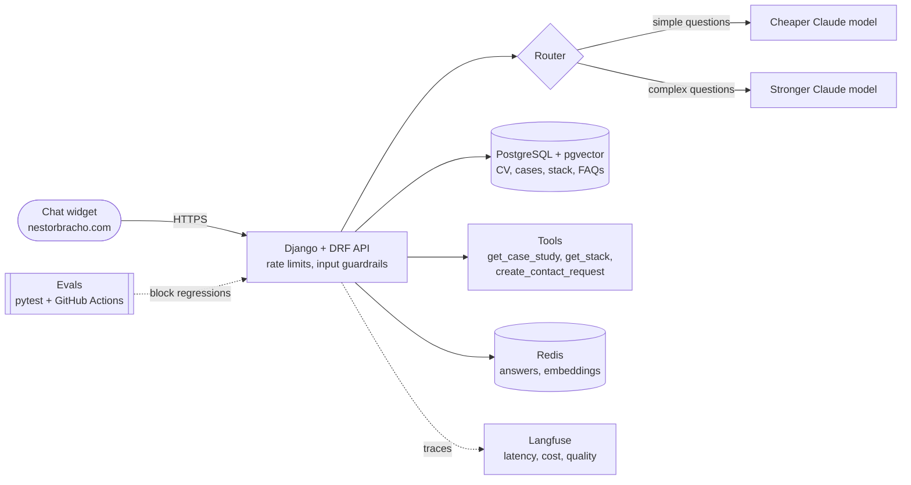

# Portfolio assistant


[](https://github.com/astral-sh/ruff)


The backend of an AI assistant for my site, **[nestorbracho.com](https://nestorbracho.com)**: a chat on the home
page that answers questions about my experience, my projects and the stack I work with. It has two audiences:

- **Recruiters**: "Has he worked with AWS?", "What did he do for the World Bank?", "Is he available?"
- **Freelance clients**: "Can he build me a WMS?", "How does he work?", "How do I get in touch?"

It is also meant to be evidence of AI engineering in production: retrieval-augmented generation, tool use,
guardrails, automated evaluations, caching, model routing and observability, each one added with a measured
before and after.

**Live demo:** coming soon.

## Where to look

| To see...                      | Look at                                                            |
|--------------------------------|--------------------------------------------------------------------|
| What is being built and why    | [`docs/brief.md`](docs/brief.md): goals, constraints, phases (in Spanish) |
| Why it is built this way       | [`docs/adr/`](docs/adr): architecture decision records             |
| What the assistant knows       | [`knowledge/`](knowledge): the versioned knowledge base, in Markdown |
| The settings it will need      | [`.env.example`](.env.example)                                     |

## Principles

1. **In production from phase 1.** Every phase ends deployed, not on a branch.
2. **Measure before optimizing.** No layer is added without a metric from before and after it.
3. **No invented experience.** The assistant only states what is in the knowledge base. When it doesn't know, it
   says so and offers a way to get in touch.
4. **Controlled cost.** There is a monthly spending cap of 10 EUR, and the assistant degrades gracefully when it
   reaches it ([ADR 2](docs/adr/0002-a-monthly-spending-cap.md)).
5. **Everything documented.** Every relevant decision is recorded as an ADR in [`docs/adr/`](docs/adr).

## Design decisions

1. [A separate, public repository](docs/adr/0001-a-separate-public-repository.md)
2. [A monthly spending cap of 10 EUR](docs/adr/0002-a-monthly-spending-cap.md)
3. [A single EC2 instance with Docker Compose](docs/adr/0003-ec2-with-docker-compose.md)
4. [Answer in the language of the question](docs/adr/0004-answer-in-the-language-of-the-question.md)

## Planned architecture



## Planned stack

- **Backend:** Python 3.12, Django, Django REST Framework
- **LLM:** the Claude API, routing between a cheaper model (Haiku family) and a stronger one (Sonnet family)
- **Retrieval:** PostgreSQL with pgvector, so the vectors live in the same database as everything else
- **Cache:** Redis
- **Observability:** Langfuse, self-hosted with Docker
- **CI:** GitHub Actions, running the evaluations on every pull request
- **Infrastructure:** AWS and Docker, on a single EC2 instance with Docker Compose
  ([ADR 3](docs/adr/0003-ec2-with-docker-compose.md))
- **Tooling:** ruff, pre-commit, gitleaks

## Phases

Each phase is done only when it meets its definition of done and its metrics are recorded. The details are in
[`docs/brief.md`](docs/brief.md#5-fases).

| # | Phase                        | What it adds                                                                 | Status  |
|---|------------------------------|------------------------------------------------------------------------------|---------|
| 1 | Model, prompt and logging    | `POST /api/chat/`, a system prompt, every message logged with tokens, latency and cost | planned |
| 2 | RAG                          | Knowledge base ingestion into pgvector, retrieval and citations              | planned |
| 3 | Evaluations                  | A suite of at least 30 cases in CI that blocks deploys on regressions        | planned |
| 4 | Tools and access control     | `get_case_study`, `get_stack`, `create_contact_request`, an admin panel       | planned |
| 5 | Guardrails                   | Prompt injection and off-topic detection, checks on confidential data        | planned |
| 6 | Cache and router             | Redis cache, a cheap/strong model router and the monthly spending cap         | planned |
| 7 | Observability                | Langfuse traces, evaluation scores over time, user feedback and alerts       | planned |

The evaluations come third on purpose, so every later layer is measured against them.

## Running locally

There is no application code yet: phase 1 starts the Django project. Until then, the repository only has the brief,
the knowledge base and the tooling. To check a change before committing it:

```bash
python3 -m venv venv
source venv/bin/activate
pip install pre-commit
pre-commit install  # ruff and gitleaks before every commit
pre-commit run --all-files
```

[`.env.example`](.env.example) lists every setting the assistant will need. Copy it to `.env` and fill it in;
the real `.env` is never committed.

## Content rules

The repository is public. It never holds secrets or client data, and the knowledge base only contains what is
already public on my CV and my site. Some clients are presented anonymously, and the assistant must keep them that
way even when asked directly. The full rules are in section 3 of the [brief](docs/brief.md#3-restricciones-de-contenido-obligatorias).
gitleaks runs before every commit to keep keys out of the history.

## How this was built

The brief, the phases and the decisions in [`docs/adr/`](docs/adr) are mine. The code is written with Claude Code as
a pair programmer, following the BMAD Method for planning; commits it co-wrote say so in a `Co-Authored-By: Claude`
trailer.
